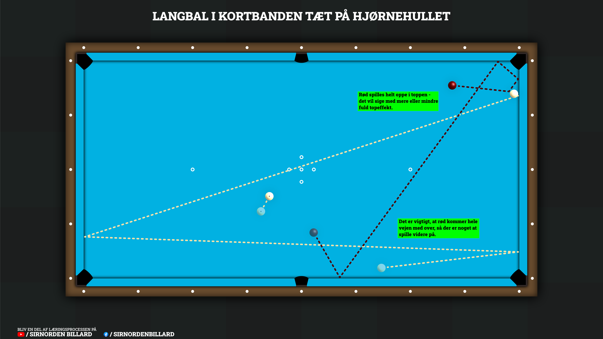

## Den hurtige version
Løs problemet med, at rød konsekvent ryger i hjørnehullet, når du spiller en langbal tæt på kortbanden i nærheden af selvsamme hul:

Sigtet: Find dit sigte på den hvide ved hjælp af dit foretrukne langbal-system (mit [langbalsystem](/posts/Fjerdedel-systemet-til-langbal) er rigtig godt til dette).

Stødet og effekten: Glem alt om at spille i bunden. Spil i stedet rød helt i toppen (maksimal topeffekt). Det gør, at rød straks søger i banden efter at have ramt hvid og undgår at bliver trukket i hullet.

Tempoet: Afhænger af situationen:

- Trille-modellen: Hvis du har en direktør klar, kan du trille hvid roligt ud (eller bruge den til muligt sortlæg i skomar).
- Højere tempo: Hvis rød skal med på tværs af bordet for at gøre bal 3 spilbar, øger du tempoet. Topeffekten får rød til at lave et lille "hop" fra kortbande og over i langbanden, hvorefter rotationen bremser den og sender den på tværs af bordet.

---

## Den detaljerede version
I denne uges dessin skal vi se på en løsning til et lille problem, som mange spillere har. Jeg har selv været der også, og jeg ved af erfaring, at det er virkelig frustrerende, når det sker. Men det er heldigvis noget, vi kan fixe, så lad os da lige få løst det problem én gang for alle, så vi ikke skal døje med det mere!

### Når den røde ryger i hjørnehullet
Situationen, jeg tænker på, er den berømte langbal, der ligger i kortbanden helt ude i nærheden af hullet, og med en bal 3, der ikke rigtigt er tilgængelig, så man er nødt til at spille sin langbal - for en bedre beskrivelse kan man se [illustrationen](#sådan-undgår-du-hjørnehullet-med-topstød-i-den-røde). Her har mange en tendens til at tænke, at den røde ikke skal ud og løbe specielt meget, så de støder instinktivt deres langbal i bunden, ofte også med en smule skævt for at hjælpe den hvide ind. MEN så sker det... Den dundrende lyd af fenolplast/fenolharpiks, der banker mod nogle stykker træ... Med andre ord: Den røde er gledet direkte over i hjørnehullet.

Det kan være frustrerende, specielt hvis man sætter sin langbal og kunne have glæden af at fortsætte. Men nej, det må man ikke, for den røde er gledet i hjørnehullet. Man stiller sig så og tænker over, hvorfor det altid sker for en, men bliver enig med sig selv om, at man bare er uheldig, og at det nok skal gå godt næste gang... Spoiler alert: Det gør det ikke, der sker det samme igen, og så er man fanget i det endeløse loop, hvor det bliver ved med at ske.

### Sådan undgår du hjørnehullet med topstød i den røde
MEN det var jo så lige indtil nu, for det skal vi altså have løst! For dem, der har været med lige siden [opslag nr. 14](/posts/Lært-i-Keglebillard-14) tilbage fra den 8. april, vil allerede have en fordel: De kender meget af teknikken, for der er faktisk en del gengangere - specielt hvis man skal have rød med på tværs af bordet. Så lad os få det løst nu!

  
  <em class="d-block text-center mt-2 text-muted">
    Illustration af hvordan man spiller en langbal i kortbanden tæt på hjørnehullet med topeffekt i den røde, så den ikke ryger i hul.
  </em>

  

Hemmeligheden ligger i, at selvom det kan virke forkert, så skal man faktisk spille den røde i toppen. Og ikke bare sådan lidt over midten - nej, vi skal helt op i toppen. Når vi gør det, sørger vi for, at når rød har ramt hvid, vil den øjeblikkeligt søge mod banden igen, hvorfra den søger væk igen og derved undgår hjørnehullet.

Selve tempoet, man skal spille i, afhænger af, hvad den røde skal bagefter:

Hvis man i fortsat keglebillard har en direktør liggende, man kan tage bagefter, kan man blot trille den hvide ud i samme tempo, som vi gjorde i [opslag nr. 40](/posts/Lært-i-Keglebillard-40).

Ligger man det derimod som i mit eksempel, skal den røde helst på tværs af bordet, så vi i det mindste kan spille videre på bal 3 bagefter. Det heldige for os er, at hvis dette er nødvendigt, skal vi blot øge tempoet i vores langbal, da topstødet igen sørger for, at rød kommer hurtigt ind i banden. Ved det højere tempo vil den dog lave et lille "hop" over i langbanden efterfølgende, hvor den stadig har bevaret noget af topeffekten, som faktisk bremser den (da rød roterer imod løberetningen) og sørger for, at den i stedet slår på tværs af bordet, så man kan komme over til sin bal 3.

(Note, specielt til skomarspillerne: Har I et lignende oplæg, så vælger I bare trillemodellen i stedet, da det næsten sikrer et sort oplæg).

Når man har kigget på bal 3 og fundet ud af, hvilken model man skal spille, beregner man, hvor man skal ramme sin langbal - skal man bruge hjælp til det, kan man finde mit [langbalsystem](/posts/Fjerdedel-systemet-til-langbal) her på siden. Herefter afleverer man blot sit stød alt efter situationen, og... voilà, nu er problemet med hjørnehullet pist væk og aldrig noget, man skal bekymre sig om mere.

Lad os kort gennemgå mit eksempel fra [videoen](#se-stødet-udført-her): Her har jeg for det første brugt mit langbalsystem til at finde ud af, hvor jeg skal ramme den hvide. Jeg noterer mig samtidig, at jeg skal spille den med et relativt hårdt tempo, så jeg er sikker på at få rød med over i modsatte side, så jeg som minimum har noget at spille på bagefter. Jeg stiller mig herefter an og tager sigte. Den røde spiller jeg helt i toppen, så jeg er sikker på, at den ryger direkte i banden efter at have ramt den hvide. Jeg foretager derefter mit stød, hvor jeg sætter min langbal og får den røde på tværs af bordet til et synligt oplæg på næste stød. SUCCES!

Og så lige en ekstra ting: Jeg var endda heldig, at den ene kegle lige skubbede lidt til bal 3, så der ligger en rigtig god dobbeltspids, som jeg efterfølgende kan spille til tempo og derved få en direktør... ENDNU MERE SUCCES (og en smule heldigt!).

---

### Se stødet udført her


{: .mt-4 }

Mobil-venlig version kan findes ved at [TRYKKE HER](https://www.youtube.com/shorts/ApfKPJYNj-0)

---

### Risikoen er lavere end med stød i bunden
Når det kommer til risiko, er det af temmelig lav risiko. Der kan ikke rigtig gå noget galt - kun hvis man spiller den som trillemodel i stedet for at spille direktør. Spiller man den som en overlevelsesbal, hvor man bare skal have den røde med på tværs af bordet, så er det værste, der kan ske, at man brænder den; man efterlader ikke nogen direktør eller lignende. Den her model er faktisk af lavere risiko end at støde i bunden, da den her ikke har samme mulighed for at løbe i hullet... eller jo, det kan ske, men så er man også virkelig uheldig, så der er ingen undskyldning!

Jeg håber, I kan bruge dette lille dessin i jeres spil, så I endelig kan få styr på de der langballer, der ligger ude i hjørnerne. De skal jo helst ikke ryge i hul, og denne model vil helt klart hjælpe med det, så det er bare om at træne den! Så... afsted til det der træningslokale det gik!

Har du spørgsmål, så skriv dem endelig på facebook, linket til opslaget finder du ved at trykke på facebook knappen nedenfor!! En dag skal der nok være nogen, der siger, at de har fundet deres nye favoritdessin.

Held og lykke og god træning!

  <a href="https://www.facebook.com/reel/2319511502218983/" class="btn btn-outline-primary shadow-sm rounded-pill" target="_blank" rel="noopener">
    <i class="fab fa-facebook-f me-2"></i> Deltag i debatten eller stil dine spørgsmål på Facebook
  </a>

