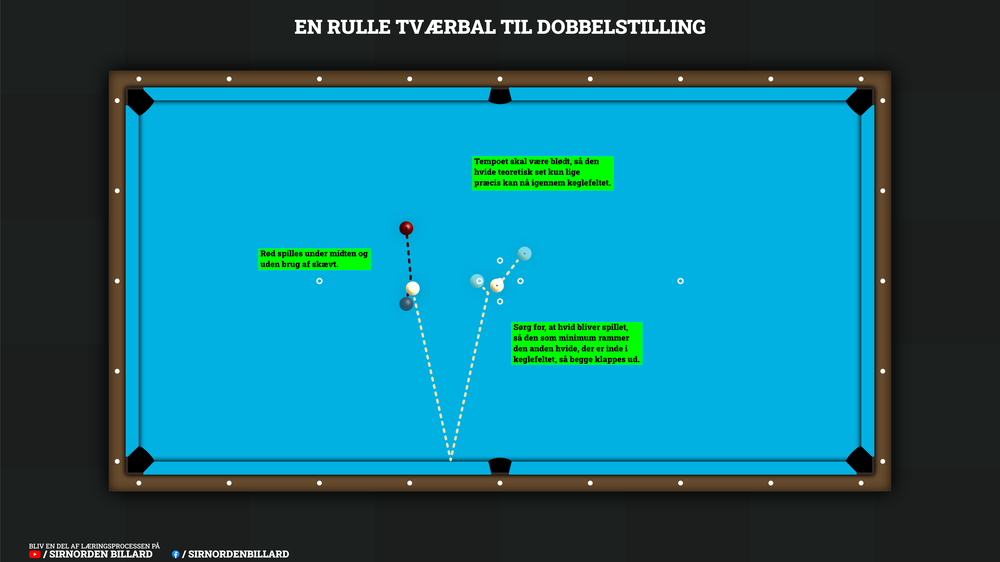

## Den hurtige version
Løs den klassiske tværbal, hvor en af de hvide ligger placeret inde i keglefeltet, ved at spille en blød og nænsom rullebal:

Stødteknikken: Forkort din bro et par centimeter, og ryk baghånden en smule frem. Det begrænser bevægeligheden automatisk og sikrer et blødt og kontrolleret stød.

Sigtet og fokus: Beregn din tværbal som normalt. Dit eneste fokus er at ramme den hvide inde i keglefeltet, så begge hvide skubbes ud - ellers risikerer du et dårligt oplæg til dig selv.

Effekten og tempoet: Spil rød lige under midten helt uden skævt i et blødt tempo, hvor hvid kun akkurat kan nå om på den anden side af keglefeltet.

Resultatet: De hvide klapper kontrolleret uden at trille væk, og rød bliver liggende, hvilket giver næsten statsgaranti for en perfekt dobbeltstilling.

---

## Den detaljerede version
I denne uge skal vi se på en rigtig klassiker, som jeg faktisk tror, vi alle har oplevet mindst én eller flere gange... nogen flere end andre. Jeg oplevede det også i starten, men så slog min gode ven Jimmy Lauridsen mig lige oven i hovedet, så jeg lærte, at det gør vi ikke mere - og jeg har... næsten... NÆSTEN ikke gjort det siden!

### Når den ene hvide ligger i keglefeltet
Hvad er det så for en situation, tænker du nok? Se, det er faktisk den berømte situation, hvor en af de hvide ligger placeret inde i keglefeltet, og man står med en tværbal! Og så er det nu, folk skal være ærlige... Bare rolig, ingen andre kan se jer, og hvis de kan, ved de ikke, hvorfor I gør det, men... Ræk lige hånden i vejret, hvis I også har prøvet enten at støde meget eller bare en smule for vildt og voldsomt til den tværbal, så det efterfølgende oplæg har været af tvivlsom karakter. Se, der skete ikke noget ved at indrømme det; det er kun mig, der lige får et slag oven i hovedet af Jimmy, hvis det sker!

### Kort bro og baghånden frem: sådan støder du blødt og nænsomt
Spøg til side: Inden vi går videre til, hvordan dessinet så spilles, skal vi lige hurtigt have teknikken på plads, så vi alle kan gå fra at støde vildt og voldsomt og over til at støde blødt og nænsomt. Selve det at støde blødt og nænsomt kræver sådan set egentlig kun to ting: en kortere bro og så, at baghånden kommer med frem. Normalt står vi ideelt med ca. 15 cm bro og en baghånd, der står lodret i 90 grader. Skal vi støde blødere, kan vi blot lige tage et par centimeter af broen og rykke baghånden en smule frem. Dette begrænser bevægeligheden en smule, sådan at der ikke kan stødes lige så hårdt. Kombineres dette med et gennemført stød, kan den hvide sagtens få fart nok til at komme ind til keglerne.

Og så én ting mere: Nu tænker du nok, hvorfor man skal rulle den stille? Svaret er ganske simpelt: Ruller man tværballen stille og roligt, klapper de hvide ikke hinanden væk, og samtidig... ligegyldigt hvordan de klapper, er det næsten umuligt ikke at stå med en dobbeltstilling af en art! Og det kan vi jo rigtig godt lide at få, så vi kan lave mange point. Derfor støder vi blødt og nænsomt i fremtiden i de her situationer.

### Sådan ruller du en tværbal til en dobbeltstilling, når den ene hvide ligger i keglerne
Hvordan spiller man så det her dessin? Det er faktisk slet ikke svært på nogen måde - det er en ganske almindelig tværbal, og hvis man lige skal have et system til det, kan man finde mit [tværbalssystem](/posts/Tredjedel-systemet-til-1gangs-tvaerbal) her på siden.

  
  <em class="d-block text-center mt-2 text-muted">
    Illustration af hvordan man ruller en tværbal stille og roligt til en dobbeltstilling, når den ene hvide ligger i keglerne.
  </em>

  

Selve ens fokus, når man spiller denne tværbal, skal være på én ting og kun én ting (udover selvfølgelig at ramme og få kegler): Nemlig at man skal ramme den hvide inde i keglefeltet, sådan at begge hvide ender med at blive skubbet ud, ellers kan man risikere at efterlade noget rigtig dårligt til sig selv på det efterfølgende stød.

Når man har fundet det sted, man skal ramme for at få kegler, og man samtidig er sikker på, det også sørger for, man rammer den hvide, stiller man sig an med en kort bro, baghånden en smule længere fremme som beskrevet ovenover, og så laver man et stille rullestød svarende til, at den hvide kun lige skal kunne nå om på den anden side af keglefeltet. Så vil man få kegler, og de hvide vil klappe kontrolleret til en dobbeltstilling. Og nå ja, den røde? Den stødes selvfølgelig lige under midten uden skævt - den skal nemlig ikke ud og arbejde!

Lad os kort gennemgå mit eksempel fra [videoen](#se-stødet-udført-her): Her har jeg anvendt mit tværbalssystem for at være sikker på, hvor jeg skal ramme for at få kegler. Jeg har samtidig bemærket, at dette indfald, som hvid får, vil sikre, at den rammer den anden hvide. Herefter stiller jeg mig an med en kort bro og baghånden en smule længere fremme på køen, og så afleverer jeg et blødt og nænsomt stød under midten på rød. Dette resulterer i, at den hvide ruller ind i en stille tværbal, hvorefter den støder sammen med den anden hvide; rød ligger mere eller mindre samme sted, og jeg står nu med en perfekt dobbeltstilling til mange point. SUCCES!

---

### Se stødet udført her


{: .mt-4 }

Mobil-venlig version kan findes ved at [TRYKKE HER](https://www.youtube.com/shorts/R5N5FeK4kuA)

---

### Næsten risikofrit
Dessinet er samtidig virkelig risikofrit, så det kan faktisk ikke blive bedre. Støder man for hårdt, ved man allerede, hvad der sker, og skulle det ske, at man misser helt, ligger der sku ikke særlig meget godt til modstanderen. Eneste lille "men" er, hvis man får et virkelig uheldigt klap - det sker ikke ofte, men det kan ske i sjældne tilfælde, og så må man bare leve med det.

Det var ugens dessin - et virkelig nyttigt et af slagsen, som bare skal blive en del af ens repertoire. Det er samtidig meget simpelt at træne: Det er bare at gå ned og lægge den op og så fokusere på tempoet... det kommer en til gavn i mange andre situationer også! Så afsted til det der træningslokale det gik, blev der sagt!

Har du spørgsmål, så skriv dem endelig på facebook, linket til opslaget finder du ved at trykke på facebook knappen nedenfor!! En dag skal der nok være nogen, der siger, at de har fundet deres nye favoritdessin.

Held og lykke og god træning!

  <a href="https://www.facebook.com/reel/1662255438862626/" class="btn btn-outline-primary shadow-sm rounded-pill" target="_blank" rel="noopener">
    <i class="fab fa-facebook-f me-2"></i> Deltag i debatten eller stil dine spørgsmål på Facebook
  </a>

