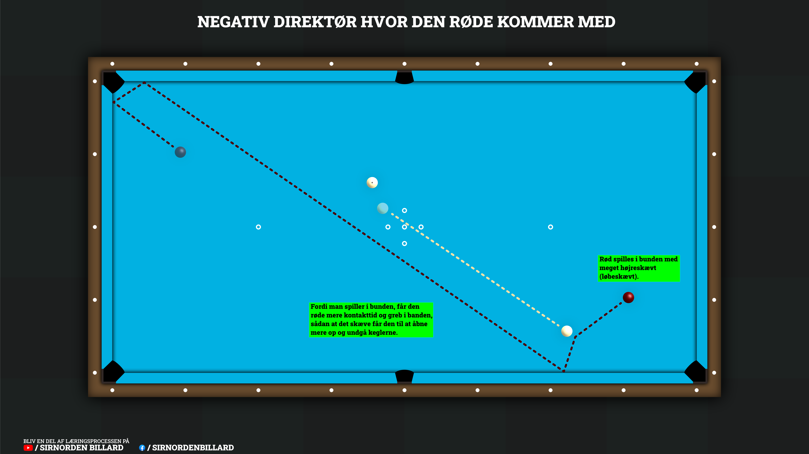

## Den hurtige version
Løs den drilske snitbal nede i hjørnet med negativ vinkel, hvor rød har en særlig tendens til at fræse direkte op i keglerne, før hvid når frem:

Sigtet: Find dit sigte på hvid, og husk, at løbeskævt skubber hvid lidt fremad, så gå ikke alt for tykt på.

Stødet og effekten: Hemmeligheden er ikke bare mere skævt, men hvor du rammer rød. Spil rød helt dybt i bunden (de nederste 25 %) kombineret med maksimalt løbeskævt - hæv evt. køen et par grader.

Fysikken: Underskruen bremser rød og får den til at "grave" sig ned i bandegummiet. Det giver det skæve maksimal kontakt og greb til at åbne vinklen og styre rød sikkert uden om keglefeltet.

Tempoet: Spil et behersket og gennemført stød, så hvid kun akkurat når gennem keglerne.

---

## Den detaljerede version
Ugens dessin er en langt om længe ventet fortsættelse til [opslag nr. 33](/posts/Lært-i-Keglebillard-33) tilbage fra 19. august. Her så vi på en direktør/snitbal, der lå nede i det ene hjørne, hvor vi spillede den røde med kontraskævt og tvang den over midten af bordet til en direktør på bal 3. Dengang lovede jeg, at jeg inden for 10 uger ville poste en anden model, hvor man i stedet spiller sin snitbal og tager rød med ned i den anden ende... det endte så lige med at tage 13 uger i stedet. Jeg beklager - fejlen er min, det kan ske for selv den bedste, og det gjorde det så... igen... denne gang... man er vel menneskelig... af og til! Husk på, jeg freestyler meget af det her, og planlægning er altså ikke ligefrem min stærke side.

### Den negativ snitbal nede i hjørnet
Men lad os lige genopfriske situationen (skal man bruge noget visuelt, så se den i [videoen](#se-stødet-udført-her) eller på [illustrationen](#sådan-spiller-du-en-negativ-snitbal-med-skævt-og-underskrue)). Det er den klassiske situation med en bal nede i det ene hjørne, som kan spilles som en direktør/snitbal, men til forskel fra [opslag nr. 33](/posts/Lært-i-Keglebillard-33) ligger bal 3 på modsatte halvdel af bordet, så vi i stedet skal hen og have den røde med ned i den anden ende for at have noget at spille på bagefter. Og ligesom sidst ligger den røde i en negativ vinkel på hvid - dvs. at den røde ligger længere inde på bordet end hvid og har en naturlig vinkel direkte over i langbanden, når man spiller sin snitbal. OG det er jo faktisk en situation, der - selvom man ikke skulle tro det - kan have en tendens til at skabe problemer pga. en lille bitte, men meget irriterende fælde. Så folkens... tid til fælles håndsoprækning endnu engang!

Hvor mange har stået i en lignende situation, hvor de har været rigtig glade for at få sådan en direktør, og så er gået ind og spillet deres snitbal med løbeskævt for at få den røde med, og så set den røde fræse direkte op i keglerne, før den hvide overhovedet er nået derop??? Jeg ved, der er rigtig mange, der har gjort det før, og nøj, hvor kunne det være fedt, hvis nogen lige ville gå forrest med et godt eksempel i kommentarsektionen på Facebook (knappen finder du nederst på siden), så folk ved, de ikke er de eneste, men derimod er mange, det er sket for! Det er også sket for undertegnede en gang eller to... eller mange... før, men det er heldigvis løst, og den løsning er den, jeg skal fortælle jer i dag.

### Derfor ryger den røde op i keglerne
Men først skal vi lige have årsagen. Grunden til, at det sker, er nemlig, at ved sådan en negativt vinklet snitbal har man et tæt på vinkelret indfald i langbanden. Kombinationen af dette og det skæve, man giver, driver den røde ind i en bane, der passer perfekt med en tværbal, som naturligt leder mod keglefeltet. Nu sidder du nok og tænker, at du allerede spiller den røde med fuldt skævt - og hvis du ikke kan gøre det, hvordan skal du så få den røde med?

Derfor skal vi lige se på en lille ting omkring skævt/spin, som nok vil overraske nogen. Det viser sig nemlig, at det ikke handler om, hvor meget skævt du giver den, men derimod hvor på den røde du rammer. Hvis du støder i toppen eller omkring midten med fuldt skævt, ruller den røde hurtigere ud af banden igen pga. det naturlige rul. Den højere fart ud fra banden tager simpelthen toppen af det skæve, så man ikke får den store åbning, fordi den tid, den røde har kontakt med banden, ikke er specielt stor.

Støder man derimod i bunden af den røde samtidig med, at man giver skævt, skaber man underskrue. Det bremser den rødes fart ud fra banden, samtidig med at den "graver" sig bedre ned i bandegummiet og holder længere kontakt. Det giver det skæve maksimal tid og greb til at arbejde, så det får markant bedre effekt end ved et helt normalt stød i midten... i nogle situationer faktisk mere end ved fuldt skævt! Det er dette trick, vi skal hen og udnytte for at undgå, at den røde ryger i keglerne ved den negative snitbal... så lad os se på, hvordan det gøres.

### Sådan spiller du en negativ snitbal med skævt og underskrue
Det er i sig selv ikke specielt kompliceret (det er trods alt en direktør). Det første, man lige gør, er at gå hen og se, hvor man skal ramme den hvide for at få den i keglerne - og så husker man lige på, at når vi spiller med løbeskævt, har det en tendens til at skubbe den hvide en smule fremad, så vi kan med stor sandsynlighed også tillade os at sigte en smule til den tynde side, med andre ord undgå at gå for tykt på… Når man ved, hvor man skal ramme, stiller man sig an og sigter sin snitbal, så den går imod keglerne.

  
  <em class="d-block text-center mt-2 text-muted">
    Illustration af hvordan man bruger skævt i bunden til at forlænge effekten i den røde ved en negativ snitbal nede i hjørnet.
  </em>

  

Den røde spiller man med så meget skævt som overhovedet muligt, men dybt i den røde - ca. nede omkring de laveste 25 % af ballen. Er man virkelig i tvivl, kan man hæve køen en meget lille smule (højst et par grader) for at være sikker på at få nok underskrue i. Herefter udfører man stødet i et passende tempo til, at hvid lige akkurat kan komme op og ud på den anden side af keglefeltet... Så skal I bare se den røde arbejde med skævt i langbanden, som I aldrig har set den arbejde før! Den kommer virkelig til at åbne op, og rød bliver virkelig hurtigt tilmed.

Lad os tage et kig på mit eksempel fra [videoen](#se-stødet-udført-her). Det skal her siges, at jeg godt ved, den røde kommer tæt på keglerne (den er ca. 1 bal fra yderkeglen). Det er ikke fordi, teknikken ikke virker - det er fordi, jeg for eksemplets skyld presser citronen så meget for, hvad der næsten er muligt. Det er en ekstremt negativ vinkel, den ligger i (kameraet retfærdiggør virkelig ikke vinklen); vi er ude i så stor en vinkel, at jeg i en kamp ville genoverveje at spille den på den måde, men for eksemplets skyld valgte jeg at gøre det, blot for at vise, at det er muligt!

Men ja, i eksemplet har jeg udset mig, hvor jeg skal ramme den hvide for at få den i keglerne. Mit sigte er efter yderstriben, da jeg ved, at det skæve vil skubbe hvid fremad og forlænge den, så den får samme udfald, som hvis jeg kommer tykkere på. Den røde støder jeg under midten med så meget løbeskævt som muligt - dette er i mit tilfælde højreskævt. Skal man bruge ur-analogien, svarer det til, at jeg rammer, hvor den lille viser er ca. kl. 4:30, samtidig med at jeg hæver køen et par grader (godt hjulpet af banden) for maksimal underskrue. Selve stødet er for afstanden gennemført og i et behersket tempo. Dette gør, at jeg får direktøren snittet i keglerne og skaber maksimal underskrue i rød, sådan at det skæve virker nok i banden til akkurat at sende rød udenom keglerne fra selv en relativt ekstrem negativ vinkel, så jeg får en dobbeltstilling. SUCCES!

Og så lige en lille note: Gør I det til en vane at bruge denne metode som standard, er I mere eller mindre sikre på, at den røde aldrig går i keglerne igen... Nu ved I, det er muligt!

---

### Se stødet udført her


{: .mt-4 }

Mobil-venlig version kan findes ved at [TRYKKE HER](https://www.youtube.com/shorts/hCXvZRMprgc)

---

### Risikoen afhænger primært af, hvor negativ vinklen er
Risiko… Det kommer an på, hvor negativ vinklen er. Hvis den negative vinkel er lige så stor som i mit eksempel, er den virkelig stor; det kræver maksimum koncentration, kridt, skævt og bund for at få den udenom, så det er risikabelt. I lidt mere normale omstændigheder er det dog mere risikofrit. Der er dog to ting: Som de skarpe nok har set, er der en lille tendens til at rød i nogle vinkler kan gå mod hjørnehullet - det er bare en, man må leve med; det sker, men dog ikke så tit igen.

Så er der en anden ting, der dog kan undgås: Man skal nemlig passe på tempoet, da rød med det løbeskæve hurtigt kan komme til at løbe rigtig stærkt. Tager den kortbanden først nede i spidsen, vil den løbe mod keglefeltet - støder man behersket, er det dog ikke et problem. Og så lige en sidste ting: Ikke alt for tyndt på den heller! Det skæve bremser naturligt hvid en smule, så den skal lige have kræfter nok til at kunne nå keglerne... det er nok sket for os alle en gang eller mange, at vi er faldet i den fælde.

Det var ugens dessin! Jeg håber, I kan bruge både det og teknikken til at spille jer nemmere ud af nogle situationer. Der er faktisk en del tilfælde, man kan bruge det i - dem kommer vi nok til at se på engang i fremtiden, men jeg tænkte, dette nok var den situation, den gjorde allermest nytte at stifte bekendtskab med. Såååååååå afsted til det der træningslokale det gik, så man kan få det trænet!

Har du spørgsmål, så skriv dem endelig på facebook, linket til opslaget finder du ved at trykke på facebook knappen nedenfor!! En dag skal der nok være nogen, der siger, at de har fundet deres nye favoritdessin.

Held og lykke og god træning!

  <a href="https://www.facebook.com/reel/1864624644888573/" class="btn btn-outline-primary shadow-sm rounded-pill" target="_blank" rel="noopener">
    <i class="fab fa-facebook-f me-2"></i> Deltag i debatten eller stil dine spørgsmål på Facebook
  </a>

