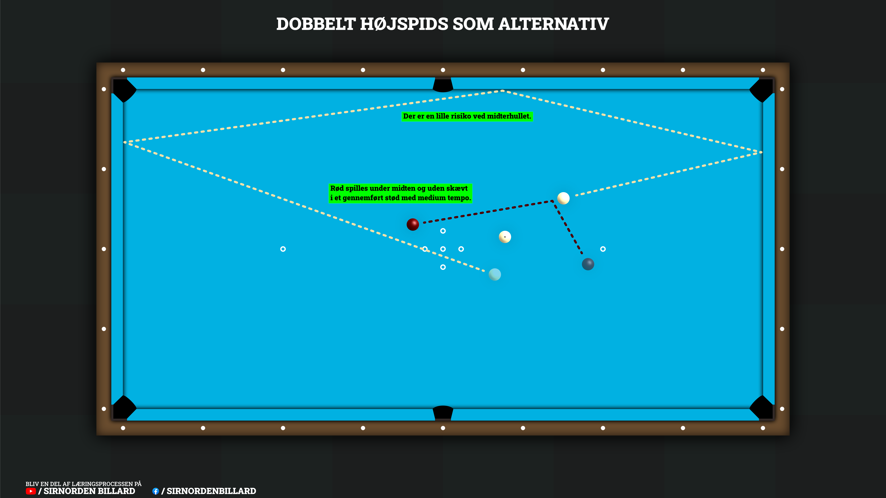

## Den hurtige version
Løs den irriterende langbal med negativ vinkel, hvor bal 3 ligger faretruende tæt på klapzonen. Hvis du vil undgå medløbskvarten, er en dobbelt højspids det perfekte alternativ:

Sigtet: Brug din grundlinje for en dobbelt højspids, og parallelforskyd den ind over midten af bal 2 for at finde punktet på kortbanden.

Stødet: Du skal ofte næsten lige på. Spil rød i bunden med et gennemført stød i medium tempo. Det får rød til at drive roligt ind mod midten af bordet.

Resultatet: Bal 2 tager dobbelt højspidsen rundt, fjerner klaprisikoen og efterlader dig med to direktører.

---

## Den detaljerede version
Denne uges dessin ved jeg ikke, om er endnu et hængeparti - kan ikke huske, om jeg lovede noget mere om dobbelt højspidser dengang, jeg gennemgik dem som en mulig løsning til direktører uden vinkel tilbage i [opslag nr. 2](/posts/Lært-i-Keglebillard-2) fra 14. januar. Hvis jeg lovede noget... så undskylder jeg, at det først kommer nu.

### Situationen
Men ja, i dag skal vi se en lille smule mere på de der dobbelt højspidser, som faktisk i nogle situationer kan være en rigtig god løsning, hvis man ved, hvordan de skal spilles. Situationen, vi skal se på, er den der rigtig irriterende situation, hvor der ligger en langbal med negativ vinkel, og bal 3 ligger gemt inde foran keglefeltet i sådan en irriterende position, at der er risiko for, at den klapper med bal 2, når man spiller langballen - eller ligger så de begge klappes væk, hvis man spiller 2.-gangs langbal. Hvis man skal bruge den helt specifikke situation, så kig lige på [illustrationen](#sådan-spiller-du-den) længere nede.

Når det så er sagt, skal vi lige have én ting på det rene: Nogle spillere vil nok vælge at spille en medløbskvart i sådan en situation. Det er i hvert fald også en mulighed... og en rigtig god en faktisk. Det er endda nok den, jeg selv ville vælge, men der er nogle spillere, der bare ikke er så stærke i de der medløbskvarter, og det er jer, som jeg håber, det her opslag kan være specielt brugbart for.

### Hvorfor en dobbelt højspids?
Fordelen for nogle spillere ved en dobbelt højspids i stedet for en medløbskvart er nemlig, at i lige præcis denne situation ligger dobbelt højspidsen med sådan en vinkel, at man ofte skal mere eller mindre lige på. Dette kan gøre den visuelt mere overskuelig, og samtidig kan rød blive en smule lettere at kontrollere, hvilket gør dobbelt højspidsen til et perfekt alternativ for nogle typer spillere.

### Sådan spiller du den
Hvordan spiller man så sådan en dobbelt højspids, tænker du nok? Det er faktisk mere ligetil, end man skulle tro - specielt når man ved, hvordan man skal regne den ud. For det at regne ud, hvor man skal ramme den, er faktisk nok den første og vigtigste del. Min anbefalede måde er at bruge grundlinjen for en dobbelt højspids, som I kan finde som figur 2 i [opslag nr. 2](/posts/Lært-i-Keglebillard-2).

  
  <em class="d-block text-center mt-2 text-muted">
    Illustration af hvordan man kan bruge en dobbelt højspids som alternativ til langbal, hvis der er klaprisiko.
  </em>

  

Når man står med sin grundlinje for dobbelt højspidsen, så tager man denne og parallelforskyder hen over midten af den bal, man gerne vil spille dobbelt højspids på. Når dette er gjort, noterer man sig, hvilket punkt på kortbanden den peger på, at man skal spille mod. Når dette er gjort, skal man samtidig gøre sig den overvejelse, hvor rød skal hen: Da man ved et passende tempo vil have begge hvide på samme side af keglefeltet, er det en god idé at støde rød i bunden, sådan at denne enten stopper eller driver en lille smule mod midten af bordet (fordi man ofte skal ramme hvid en smule på siden), så man kan stå med 2 direktører bagefter. Herefter er det blot at stille sig an og sigte efter det punkt på kortbanden, man har fundet, og levere et gennemført stød i medium tempo - så skal hvid nok klare resten.

Lad os gennemgå mit eksempel fra [videoen](#se-stødet-udført-her) og illustrationen. Her har jeg parallelforskudt min grundlinje og fundet det punkt på kortbanden, som jeg skal ramme. Jeg har samtidig noteret mig, at jeg skal meget tykt på - næsten lige på. Jeg vælger derfor at gå rigtig lavt i den røde, fordi jeg godt vil have den helt ind på midten af bordet, så jeg har bedst mulig vinkel på bal 3, i tilfælde af at bal 2 løber en lille smule for langt. Herefter stiller jeg mig an til at ramme det sted på kortbanden, jeg ønsker, og støder rød i bunden med et gennemført stød i medium tempo, hvilket sender bal 2 rundt i en dobbelt højspids, og jeg ender ud i at stå med 2 direktører. SUCCES!

---

### Se stødet udført her


{: .mt-4 }

Mobil-venlig version kan findes ved at [TRYKKE HER](https://www.youtube.com/shorts/4KYR_EMEWh8)

---

### Risikoen er relativt lav
Når det kommer til selve risikoen ved at spille det her dessin, vil nogle nok blive overraskede, når jeg siger, at den faktisk er relativt lav. Bevares, lad os lige få elefanten ud af lokalet... Rammer man ikke i sådan en situation som denne, så forærer man modstanderen en direktør. Når det så er sagt, vurderer jeg stadig risikoen som ret lav: I de vinkler, hvor man vil bruge en dobbelt højspids som alternativ til medløbskvarten, skal man samtidig virkelig tykt på, hvilket gør den meget nemmere at ramme. Det er i hvert fald noget, de fleste kan gøre forholdsvis let med en smule træning... Måske ikke i forhold til tempo endnu, men det er ligegyldigt til at begynde med, for man har stadig en anden direktør efterfølgende. Når det så er sagt, er der en lille risiko ved midterhullet: Er man virkelig uheldig, kan bal 2 risikere at tage hulkanten, så man rigtig bliver snydt - det sker dog ikke særlig tit, MEN det kan ske.

Når det så er sagt, så håber jeg, at dette dessin kan være en hjælp til nogle af jer. Jeg ved nemlig, at der er mange, der ikke kan lide de der medløbskvarter, så dette dessin kan være et potentielt mere ligetil alternativ, I kan bruge, hvor I stadig har noget at spille på bagefter - specielt fordi det også eliminerer risikoen for et klap. Som altid: TRÆN DET! Det er muligvis noget, I lige pludselig kan stå og få brug for - afsted til træningslokalet det gik!

Har du spørgsmål, så skriv dem endelig på facebook, linket til opslaget finder du ved at trykke på facebook knappen nedenfor!! En dag skal der nok være nogen, der siger, at de har fundet deres nye favoritdessin.

Held og lykke og god træning!

  <a href="https://www.facebook.com/reel/2187785512160479/" class="btn btn-outline-primary shadow-sm rounded-pill" target="_blank" rel="noopener">
    <i class="fab fa-facebook-f me-2"></i> Deltag i debatten eller stil dine spørgsmål på Facebook
  </a>

