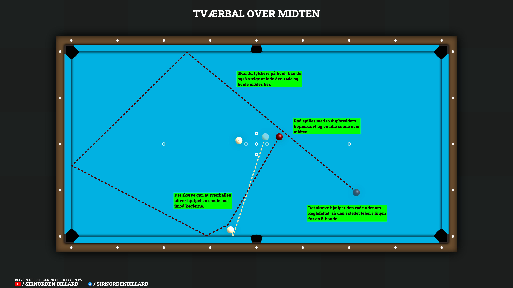

## Den hurtige version
Løs den oversete underhåndstværbal, hvor rød og hvid ligger på hver sin halvdel af bordet, så du skal spille over midten:

Sigtet og tilgang: Find punktet på langbanden, du skal ramme (brug evt. mit [tværbalssystem](/posts/Tredjedel-systemet-til-1gangs-tvaerbal)). Lås blikket fast på punktet, mens du går tilbage bag den røde, så du står i den rigtige stødlinje.

Stødet og skævt: Spil rød med en smule løbeskævt (mod keglerne) og en lille smule over midten. Det hjælper tværballen sikkert ind og sender rød ud i en sikker 5-bande linje, så den ikke truer keglerne.

Tempoet: Aflever et tempereret og gennemført stød, så hvid lige præcis når igennem keglefeltet.

---

## Den detaljerede version
Denne uges dessin er et lille, hurtigt et af slagsen, men det er faktisk et, der også opstår relativt tit. Jeg er faktisk blevet overrasket over, hvor mange der enten ikke ser muligheden for at spille den eller helt fravælger den, fordi det er for svært - det er en skam, for det er næsten et dessin med direktørgaranti... Så lad os få det ændret!

### Over midten af bordet
Selve dessinet er faktisk en ganske almindelig underhåndstværbal, men med et lille twist: Den røde og hvide ligger på hver sin halvdel af bordet, sådan at man skal hen og spille over midten af bordet (se situationen præcist i [videoen](#se-stødet-udført-her) eller på [illustrationen](#sådan-spiller-du-en-underhåndstværbal-over-midten)). Hvad der præcist gør, at folk enten overser muligheden eller synes, den er for svær, ved jeg ikke helt, MEN jeg kan meget nemt forestille mig, at det er mentalt, da dette dessin nemlig er den eneste tværbal, hvor man rent faktisk spiller over midten af bordet (normalt er en tværbal jo på samme side af bordet).

### Sådan spiller du en underhåndstværbal over midten
Så lad os hoppe direkte ud i det og se på, hvordan den spilles, for det er faktisk mere ligetil, end man skulle tro - jeg tror faktisk, de fleste vil elske sådan en tværbal efter det her. For det første: Som med enhver anden tværbal skal vi lige have fundet ud af, hvor vi skal ramme den hvide for at få den i keglerne. Skal man bruge hjælp til dette, så kan man finde mit [tværbalssystem](/posts/Tredjedel-systemet-til-1gangs-tvaerbal) her på siden.

  
  <em class="d-block text-center mt-2 text-muted">
    Illustration af hvordan man spiller en underhåndstværbal over midten af bordet, hvor rød og hvid ligger på hver sin halvdel.
  </em>

  

Når man så har fundet ud af, hvor man skal ramme, stiller man sig lige og kigger rigtig godt på det punkt, så man kan huske det. Når man har låst sig fast på det punkt, begynder man at gå tilbage bag den røde, mens man stadig holder øjenkontakt med det punkt, man skal ramme. Dette gør, at man får stødlinjen fuldstændig rigtigt på plads.

Når man stiller sig klar til at støde og har låst fast på sit punkt, skal man lige gøre sig en ekstra overvejelse, og det er, hvordan vi skal spille den røde. I dette tilfælde er det altid en rigtig god idé at spille med en smule løbeskævt - dvs. skævt i retning af keglerne - og så en meget lille smule over midten. Dette er smart af flere årsager:

Den ene årsag til, at det er smart at spille med en smule skævt, er nemlig, at man på grund af vinklen skal ramme relativt meget på siden af hvid. Fordi kontakttiden mellem rød og hvid er så relativt kort, kastes den hvide ikke helt så meget til siden, som man ellers ville forvente; dette fænomen bliver neutraliseret af det skæve. Samtidig kan hvid have en tendens til at slå en lille smule kontra i langbanden på grund af vinklen, hvilket det skæve også hjælper på. Med andre ord: Det skæve er blot til for at hjælpe den hvide sikkert ind i keglerne.

Og så er der den anden årsag, og det er faktisk meget vigtigt: De skarpe vil have bemærket, at vi spiller i en vinkel, der følger keglefeltet relativt meget... hvilket vil sige, at der er en potentiel risiko for, at den røde kan blive farlig for keglerne. Det skæve hjælper den røde med at åbne sig, så den i stedet løber i en 5-bandelinje, sådan at den ikke bliver farlig for keglefeltet. Dette er også den samme årsag til, at der er indbygget direktør i, da den ved et nogenlunde passende tempo vil mødes med hvid igen til en direktør.

Dette bringer os faktisk til den tredje ting, vi lige skal være opmærksomme på, og det er, hvor henne vi ønsker, at rød og hvid skal mødes, for at vi kan få vores direktør. Her er der en god lille huskeregel: Jo tykkere du skal på, desto hurtigere bevæger hvid sig, og rød des mindre, så der kan det være en fordel at spille på bal 3 efterfølgende, hvis man skal meget tykt på. Skal man derimod sådan halvt/halvt, kan det være en fordel at lade dem mødes over på modsatte side af keglefeltet. Og hvis man skal tyndt på, kan man samtidig tillade sig at lade rød løbe længere, for hvid kan næsten ikke få fart nok til at løbe for langt (som i mit eksempel), eller jo, hvis man virkelig støder til… men det gør vi jo ikke! Når man har gjort disse overvejelser, stiller man sig an og spiller tværballen i et nogenlunde tempereret tempo, så den kan nå keglefeltet - så klarer rød resten, og man burde stå med en direktør.

Lad os kort gennemgå mit eksempel fra [videoen](#se-stødet-udført-her): Her har jeg udset mig, hvor jeg skal ramme hvid ud fra mit tværbalssystem. Jeg går derefter tilbage til min stødbal, mens jeg stadig holder øjenkontakt med det punkt, jeg skal ramme. Når jeg går ned og gør klar til stødet, indser jeg, at jeg skal ret tyndt på, og jeg kan derfor ikke undgå, at min stødbal også bliver en smule livlig. Jeg vælger derfor at spille min tværbal en lille smule større, så jeg ved, at den hvide kommer til at ligge som en direktør bagefter (da denne så bliver langsommere). Jeg vælger herefter at spille med en smule højreskævt (da dette vil åbne tværballen), svarende til ca. 2 dupbredder og en lille smule over midten - på ur-analogien svarer det til kl. 2:30. Herefter afleverer jeg et tempereret og gennemført stød, således at hvid ruller ind til keglerne, og rød kommer naturligt rundt, så jeg står med en direktør. SUCCES!

---

### Se stødet udført her


{: .mt-4 }

Mobil-venlig version kan findes ved at [TRYKKE HER](https://www.youtube.com/shorts/M-jO-cWR8QI)

---

### Risikoen er relativt lav
Når det kommer til risiko, er det her et dessin med relativt lav risiko. Mest af alt fordi, at hvis man støder den for kort, ligger der absolut intet til modstanderen... selvfølgelig under den antagelse, at man ikke banker til den røde. Samtidig: Skulle det ske, at man får kegler og støder for hårdt, så - herre gud! Så kommer den hvide bare over mod modsatte langbande, og da rød kommer ind i en naturlig 5-bande, vil den blot fortsætte ned i spidsen, hvor den så kan vende. Så ligger der en underhåndstværbal, som man stadig kan rulle ind til en dobbeltstilling. Der er ikke den store risiko for at aflevere en direktør til modstanderen her... eller jo, så skal man støde for blødt. Men det er ikke noget, man skal tænke over - man skal bare gøre det, så går det alt sammen!

Jeg håber, at denne lille guide kan hjælpe de af jer, der har problemer med denne type tværbal. For det er virkelig et godt dessin at kunne, da man også vil kunne bruge det som en opsamlingsbal. Det er en meget stor fordel, specielt når man ved, at chancen for en direktør er stor, hvis man rammer den - så det er bare med at få det trænet. Afsted til træningslokalet det atter gik!

Har du spørgsmål, så skriv dem endelig på facebook, linket til opslaget finder du ved at trykke på facebook knappen nedenfor!! En dag skal der nok være nogen, der siger, at de har fundet deres nye favoritdessin.

Held og lykke og god træning!

  <a href="https://www.facebook.com/reel/2324409448383821/" class="btn btn-outline-primary shadow-sm rounded-pill" target="_blank" rel="noopener">
    <i class="fab fa-facebook-f me-2"></i> Deltag i debatten eller stil dine spørgsmål på Facebook
  </a>

